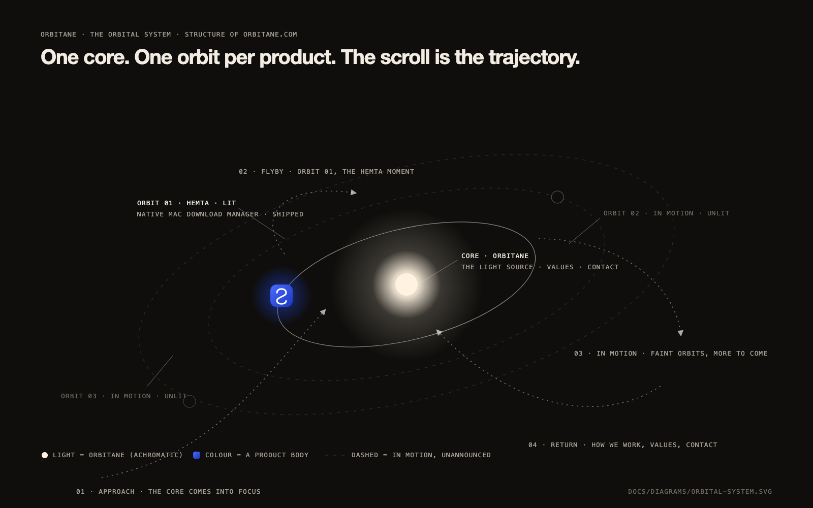
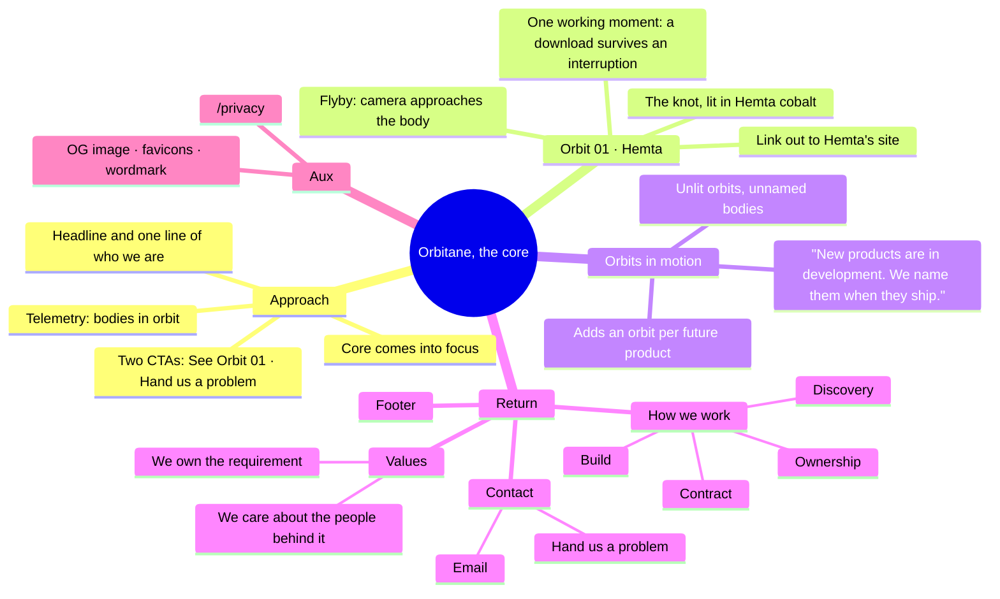
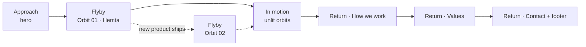

# Orbitane Site — Orbital Mindmap, Sitemap & Journey

> Source of truth for the site's structure and per-section messaging.
> Copy strings are working drafts; final copy is locked during build, section by section, inside the honesty walls in §6.
> The concept (THE ORBITAL SYSTEM) is approved in `00-brief.md`. This document turns it into a navigable structure.
>
> **Build deltas (2026-09-07):** all seven sections and `/privacy` are built as specified. In motion gained one visible element: a telemetry **probe pill** per unlit orbit (`ORBIT 02 · IN MOTION · UNANNOUNCED`), which is the accessible hover/focus handle for the orbit in the system layer. The orbit index lights orbits 02 and 03 together while In motion is centred, and lights the return dot for How we work, Values and Contact. The flyby's "Visit Hemta" CTA and the contact email pill render only once their real URL and address exist (§7). Working copy shipped as drafted; final copy lock is a founder pass.

## 1. The system in one picture

`diagrams/orbital-system.svg` is the master diagram (the body glyph on Orbit 01 is a stand-in; the site uses Hemta's real knot icon). One core (Orbitane, drawn as light), one orbit per product, bodies lit in their own colour when shipped and unlit while in development, and the visitor's trajectory in four phases.

| Term | On the site |
|---|---|
| **Core** | Orbitane. The light at the centre of the system. The site opens on it and returns to it. |
| **Orbit** | A product's path. Orbit 01 is Hemta. Every future product adds Orbit 02, 03, and so on. |
| **Body** | The product itself on its orbit, shown as its real app icon (Hemta's knot). |
| **Lit / unlit** | Shipped products glow in their own colour. Products in development are unlit outlines with no name. |
| **Approach** | Phase 1: the core comes into focus. The hero. |
| **Flyby** | Phase 2: the journey passes a body and it gets its cinematic moment. One flyby per shipped product. |
| **In motion** | Phase 3: the camera pulls back and the unlit orbits show more is coming. |
| **Return** | Phase 4: the trajectory curves back to the core: how we work, values, contact. |
| **Telemetry** | Small monospace readouts (orbit number, body name, status) tied to scroll position. |
| **Orbit index** | The mini system map in the navigation: shows where you are, jumps you between orbits. |

## 2. Orbital mindmap

## 3. Page tree (V1)

| Route | Purpose | Status |
|---|---|---|
| `/` | The journey: Approach → Orbit 01 · Hemta → In motion → How we work → Values → Contact → Footer. One page, one trajectory. | Built |
| `/#hemta`, `/#in-motion`, `/#how-we-work`, `/#contact` | Anchors used by the orbit index and the footer. Smooth-scrolled via Lenis; direct hash loads re-land after pins settle. | Built |
| `/privacy` | Plain-words privacy page (the site collects nothing without a deliberate decision, see `05 §12`). | Built |
| External: Hemta's site | Bodies link out to their own product sites. Orbitane never duplicates a product's marketing. | Depends on Hemta URL |
| Later: `/work` | Client case studies, only with written client permission. Never invented, never anonymised into "a Fortune 500 company". | Not in V1 |
| Later: `/notes` | Distilled lessons from the founder's knowledge vault. | Not in V1 |

Why one page: the concept is a trajectory. Splitting it across routes would break the camera. Products get their own sites; Orbitane's site is the system that holds them.

## 4. The journey, section by section

Layout-family diversity is a hard rule: no two sections share a layout family. Eyebrow budget: telemetry readouts replace eyebrows and appear only where the system layer is in view (max 4 on the page). Each section lists its **system state**: where the camera is and which body is lit (see `04 §2` for the exact keyframes).

### 4.0 Navigation: the island with an orbit index
- Floating pill nav (detached from the top edge), 56px: wordmark left; the **orbit index** centre (a 96×24 miniature of the system: core dot, one dot per orbit, current one lit); "Contact" pill right.
- Orbit index is real navigation: click a dot to travel to that orbit (Lenis `scrollTo`). Hover shows the body's name in telemetry type.
- Mobile: index collapses to a horizontal progress hairline with dots; the "Contact" pill stays.

### 4.1 Approach: the hero. Layout family: statement beside the system (left-aligned on desktop, centred and stacked on mobile; revised from "centred over the system" after founder review, because copy over the light was illegible)
- **System state:** wide view, core centred, all orbits visible, Hemta softly lit, unlit orbits at their faintest.
- Working headline: **"Products in motion."**
  - Alternates to test at build (pick one, never all): "Built in orbit." / "A product house that thinks in systems."
- Working subtext (20 words): "Orbitane is a product house building AI/ML products and native macOS software. The first body in orbit is Hemta."
- CTAs: primary pill **"See Orbit 01"** (travels to §4.2); secondary ghost pill **"Hand us a problem"** (travels to §4.6). Family-style pair: one product path, one people path.
- Telemetry (bottom-left of the viewport, tied to the registry, so it stays true automatically): `ORBITANE · 1 BODY IN ORBIT · MORE IN MOTION`.
- Hero stack: headline, subtext, two CTAs, one telemetry line. Four text elements. No logo wall, no badges, no tagline.

### 4.2 Orbit 01 · Hemta: the flyby. Layout family: pinned scene, asymmetric (body left, panel right)
- **System state:** camera zooms toward the Hemta body until it fills the left third at roughly 160px; its cobalt glow intensifies; every other orbit dims. This is the one section where colour arrives.
- Telemetry: `ORBIT 01 · HEMTA · NATIVE MACOS · SHIPPED`.
- Panel (right): two-tone headline **"Downloads that finish."** (white) / **"Through drops, sleep and restarts."** (Hemta cobalt-light); one line: "A native Mac download manager that captures downloads from your browser, accelerates them, and recovers them from wherever they stopped."
- **The working moment** (the proof, not a screenshot): a single download row inside a small Mac window frame. As the visitor scrolls, the bar advances, the connection drops, the state chip flips to Recovering, then the bar completes. Real Hemta lifecycle states, organic demo values (never round numbers), the same states used on Hemta's own site. Reduced motion shows the completed state with a one-line caption.
- CTA: **"Visit Hemta"** (external, opens Hemta's site). Secondary: none. One product, one action.
- Departure: on scroll-out the panel drifts away and the camera begins pulling back.
- Mobile: body sits above the panel; pin distance shortened; zoom capped (`04 §7`).

### 4.3 Orbits in motion. Layout family: full-bleed system view with one typographic statement
- **System state:** camera pulls back wider than the hero; unlit orbits brighten from their faintest to a visible hairline; unlit bodies (dark discs with a hairline rim) become visible; Hemta shrinks back to its resting size.
- Headline: **"More bodies in motion."**
- Body copy (honest by construction): "New products are in development. We name them when they ship."
- Telemetry per unlit orbit on hover: `ORBIT 02 · IN MOTION · UNANNOUNCED`. No fake names, no dates, no counts unless the founder confirms a number.
- Interaction: hovering or focusing an unlit orbit gives it a soft pulse and shows its telemetry. Nothing to click yet; the restraint is the message.
- **Scaling rule:** when a product ships, its entry in the registry changes from `in-motion` to `shipped`. The orbit lights, a flyby section is generated after the previous one, and the orbit index gains a lit dot. No redesign (`05 §5`).

### 4.4 How we work: the return begins. Layout family: waypoints along a path (horizontal rail on desktop, vertical on mobile)
- **System state:** camera turns back toward the core; a dotted return path is drawn from the outer orbits inward; four waypoints sit on it.
- Headline: **"Your problem becomes ours."**
- Intro line: "Clients hand us a problem. From that moment it is ours until it is solved. We build AI/ML products and native macOS software, and we work the same way on both."
- Four waypoints, each with a name and one concrete sentence:
  1. **Discovery.** We learn the problem and the people behind it before we propose anything.
  2. **Contract.** Design decisions are documented before build. You see the plan, and it is the contract. (These very documents are the example.)
  3. **Build.** Section by section, verified in a real browser, performance-gated.
  4. **Ownership.** We stay until it is solved, then hand over something you can run without us.
- No icons per step (waypoints are the visual). No "trusted by" strip.

### 4.5 Values. Layout family: two typographic statements, near-empty
- **System state:** core grows toward the viewport; light dominates; orbits fade to hairlines.
- Statement 1: **"We own the requirement."** Support line: "Ownership, not order-taking."
- Statement 2: **"We care about the people behind it."** Support line: "Every requirement has someone waiting on the other side of it."
- Nothing else. The restraint is the design.

### 4.6 Contact: return complete. Layout family: centred closer above the Ring (section height 65dvh so the page ends as the camera settles and the ring stays seated between the CTA and the footer)
- **System state:** the core fills the lower viewport as a soft light; the orbit index shows the journey complete.
- Headline: **"Hand us a problem."**
- One line: "Tell us what you need built. We reply personally."
- CTA: email pill (real address, dependency §7). Optional later: a short form, only if the founder wants inbound structure.
- Footer below: wordmark; Products (Hemta); Company (How we work, Contact); Legal (Privacy); one line of company facts (legal name, location, dependency §7). No social icons unless real accounts exist.

## 5. Section order and the four phases

Future flybys are inserted between the last shipped flyby and "In motion". The four-phase shape never changes.

## 6. Copy register and honesty walls

One register: plain, warm, concrete, confident. Short declaratives. Technical nouns are welcome (macOS, model, pipeline, download, checkpoint); marketing filler is not.

Banned vocabulary: seamless, blazing, unleash, supercharge, next-gen, revolutionize, cutting-edge, world-class, "trusted by", "AI-powered" as an adjective without a noun it powers. No em-dashes in any visible string (a known generic-design tell). No exclamation marks.

Honesty walls (site-wide, non-negotiable):
- No invented clients, logos, testimonials, metrics or awards. Social proof appears only when it is real and permitted.
- Unannounced products have no names, dates or feature hints anywhere, including telemetry and alt text.
- "AI/ML products" is stated as what Orbitane builds; no capability claims (accuracy, speed) without a shipped product behind them.
- Hemta facts come from Hemta's own brief and site; the flyby never claims anything Hemta's site does not.
- Demo values in the Hemta moment are illustrative and organic (8.4 GB, 34.2 MB/s), never presented as benchmarks.

## 7. Content dependencies (needed from the founder before launch)

- [ ] Orbitane wordmark and mark: the founder will generate a logo after the V1 pass; the typographic wordmark (`03 §5`) ships until then
- [x] Hemta's public URL for the flyby CTA: `https://hemta-site.vercel.app/` (2026-09-07)
- [ ] Whether to state a number of products in motion (default: no number)
- [x] Contact email address: `orbitane.ltd@gmail.com` (2026-09-07); no form in V1
- [x] Company legal name: Orbitane Limited (2026-09-07); location not stated
- [ ] Any client names or case studies with written permission (default: none in V1)
- [ ] Confirmation of the services wording: "AI/ML products and native macOS software"
